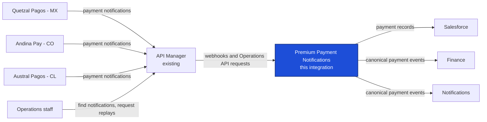
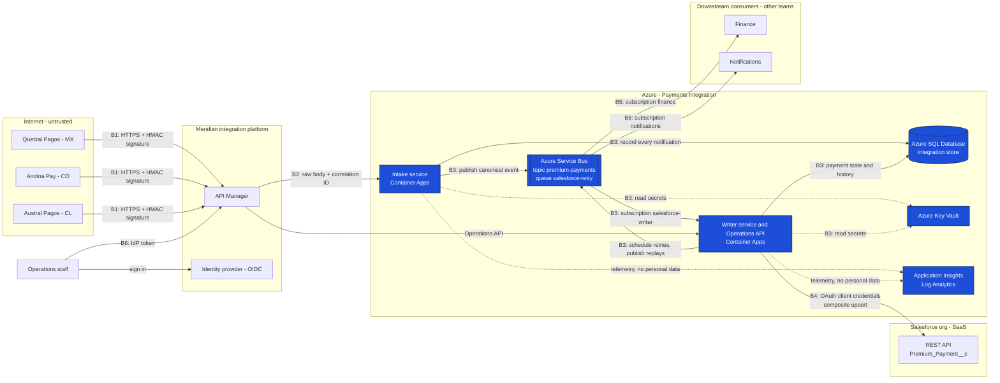
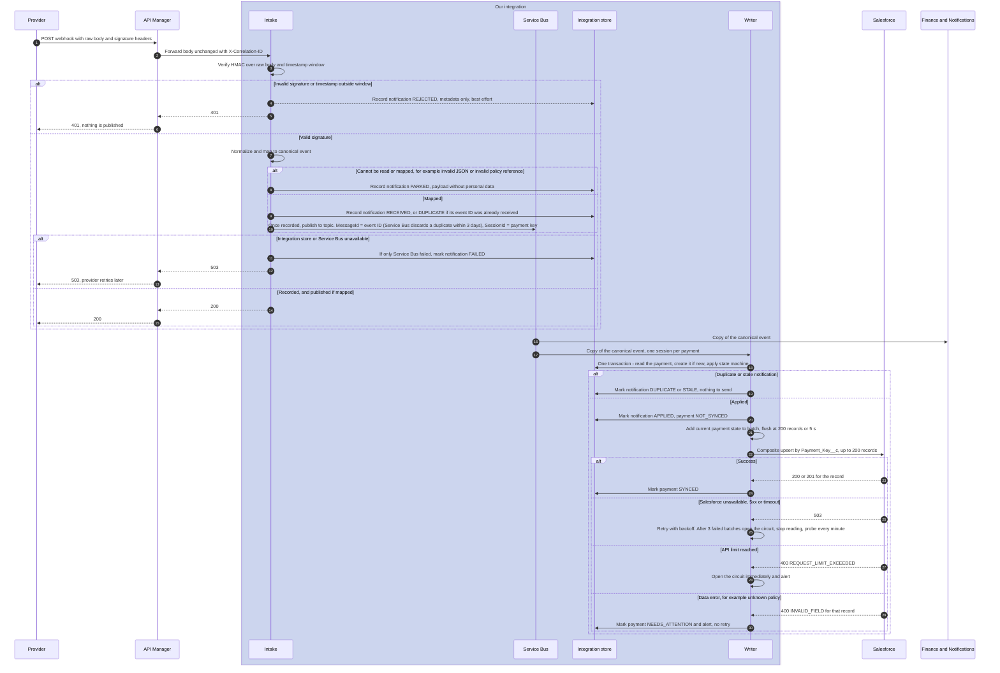
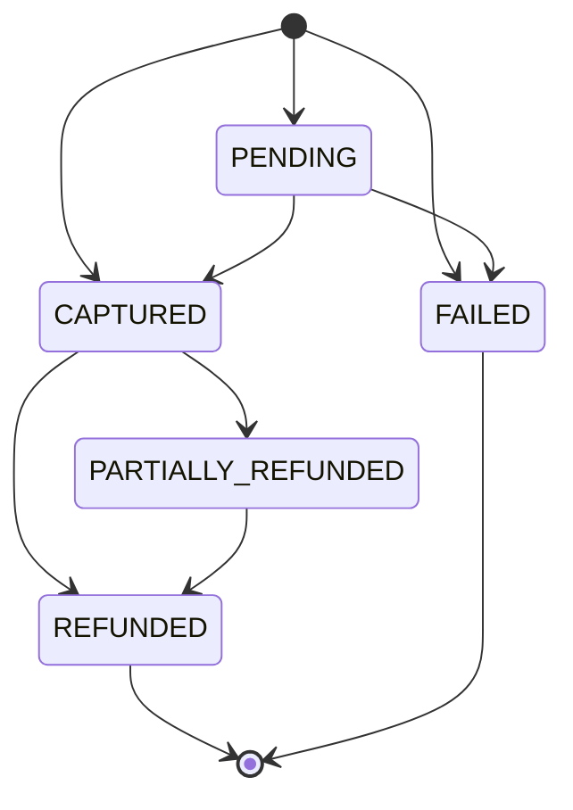

# Solution design — Premium Payment Notifications

This document describes the end-to-end design for receiving premium payment notifications from the three providers, recording them in Salesforce and publishing them to downstream consumers (FR1–FR7), within Meridian's existing ecosystem.

The main decisions and their trade-offs are recorded in the ADRs:

- [ADR-0001](../adr/0001-salesforce-integration.md): asynchronous, batched integration with Salesforce.
- [ADR-0002](../adr/0002-stack-and-data-store.md): Java 21 and Spring Boot 3 on Azure Container Apps, and Azure SQL Database.
- [ADR-0003](../adr/0003-message-broker.md): Azure Service Bus as message broker.

Assumptions are listed in [`ASSUMPTIONS.md`](../ASSUMPTIONS.md).

## Contents

1. [Context diagram and trust boundaries](#1-context-diagram-and-trust-boundaries)
2. [Sequence of one notification](#2-sequence-of-one-notification)
3. [Canonical payment event](#3-canonical-payment-event)
4. [Idempotency and ordering](#4-idempotency-and-ordering)
5. [Error handling](#5-error-handling)
6. [Capacity](#6-capacity)
7. [Data](#7-data)
8. [Operations: finding a notification (FR7)](#8-operations-finding-a-notification-fr7)

## Terms used in this document

The terms intake, writer, canonical event, payment key, payment state machine, needs attention, replay and dead-letter queue are defined in [ADR-0001](../adr/0001-salesforce-integration.md#terms-used-in-this-adr). In addition:

| Term | Meaning |
|---|---|
| Event ID | Identifier of the **business event** ("payment X was approved"). It is the same for a notification and all its retries, so it detects duplicates. |
| Correlation ID | Identifier of **one request** through all our components. It is assigned by the API Manager before the body is read, so even rejected requests have one (NFR7). |
| Parked notification | A notification with a valid signature that cannot be read or translated into a canonical event (for example, a body that is not valid JSON, a missing field or an invalid policy reference). It is accepted, kept for Operations and never guessed. |
| Operations API | Internal, read-mostly API used by Operations to find notifications and trigger replays. Published through the API Manager. |

## 1. Context diagram and trust boundaries

### System context

The integration as a single box, with the people and systems around it. The next diagrams open the box.



### Components and trust zones

The same system opened: its components, the Azure services they use, and the trust zones (Z1 to Z5). Our components are highlighted. Each B label marks a trust boundary, described under *Trust boundaries* below.



### Components

| Component | Responsibility |
|---|---|
| **API Manager** (existing) | Single public entry point. Enforces HTTPS and rate limits and forwards each webhook to the intake **without modifying the body**. |
| **Intake** (Container Apps) | Verifies the provider's signature, translates the notification into the **canonical event**, records the notification in the integration store, publishes the event to Service Bus and answers the provider. One **adapter per provider** contains all provider-specific logic. |
| **Azure Service Bus** | Stores every published canonical event durably. The topic `premium-payments` delivers a copy to each subscriber. The queue `salesforce-retry` holds the writer's scheduled retries. |
| **Writer** (Container Apps) | Applies the **payment state machine** in the integration store and writes payments to Salesforce in batches. Also serves the **Operations API**. It is the only component that calls Salesforce, and it only writes `Premium_Payment__c`: never `Policy__c` or the policy status. |
| **Integration store** (Azure SQL) | Current state of each payment and the processing history of every notification. |
| **Azure Key Vault** | Stores the providers' webhook secrets and the Salesforce client secret. |
| **Application Insights, Log Analytics** | Logs, traces and metrics of both services, without personal data (NFR7). |
| **Finance, Notifications** (other teams) | Subscribe to the topic on their own (FR6). |

Every request carries a **correlation ID** from the API Manager (`X-Correlation-ID`) through the intake, Service Bus, the writer and the integration store, so a notification can be traced end to end (NFR7). Instrumentation and alerts are described in [`OPERATIONS.md`](../operations/OPERATIONS.md).

### Trust boundaries

| Boundary | Between | Controls |
|---|---|---|
| **B1** | Providers (internet) → API Manager | HTTPS only and rate limits per provider (assumption 10). Authenticity is proven by each provider's **HMAC signature**, verified by the intake over the raw body (FR1). The API Manager forwards the body byte for byte (assumption 4). |
| **B2** | API Manager → intake | The intake only accepts traffic from the API Manager (ingress restricted to the API Manager's network addresses). It never trusts the body until the signature is verified. |
| **B3** | Our services → Azure resources | **Managed identities** with least-privilege roles; no passwords or connection strings. Secrets live in Key Vault (NFR6). Service Bus, Azure SQL and Key Vault are reached through private endpoints. |
| **B4** | Writer → Salesforce | OAuth 2.0 client credentials; the client secret lives in Key Vault; the token is cached for its lifetime (≈ 2 h). |
| **B5** | Service Bus → other teams | Each consumer has its own subscription and its own identity, with permission to read **only** that subscription. The event carries no payer personal data. |
| **B6** | Operations staff → Operations API | Token from the identity provider, required by the API Manager. Roles separate reading from replaying (section 8). |

#### Signature verification (FR1)

HMAC-SHA256 verified over the **raw bytes** of the body, with **constant-time** comparison. Quetzal: hex signature of `t.body`, any of several `v1` values may match during rotation, and `t` must be within 300 s. Andina: Base64 signature of `timestamp.body`, timestamp within 10 minutes. Austral: hex signature of the body; it has no timestamp, so replays are stopped by deduplication on `eventId` and by the state machine (section 4).

#### Secrets and identities (NFR6)

- Webhook secrets and the Salesforce client secret live in Key Vault, one secret per provider and environment. During a rotation two secrets can be active and the intake accepts either.
- Managed identities. Intake: send to the topic, read its Key Vault secrets, read, insert and update rows of `notification`. Writer: read its subscription, send to the topic (replays of parked notifications), send and read `salesforce-retry`, read and write the integration tables, read the Salesforce secret. Each downstream consumer: read only its own subscription.

## 2. Sequence of one notification

The example follows an Andina notification. The other providers follow the same flow; only the adapter differs. Our components are grouped in the blue box.



### Responses to the provider

| Situation | Response | Why |
|---|---|---|
| Accepted and published | `200` | Andina only accepts `200` or `204`, so `200` is used for every provider. `202` would be treated as a failure by Andina. |
| Duplicate of an event already received | `200` | It is already safe; an error would only cause more retries. |
| Valid signature but the body cannot be read or mapped (parked) | `200` | The notification is authentic and the payment is real. Any other code would make the provider retry the same content, which would fail again, and after its last retry the payment would be lost. It is stored for Operations, and the provider is contacted through Operations, not through error codes. If the body is not valid JSON, it is not stored, because personal data cannot be removed from it; Operations asks the provider to resend it. |
| Invalid signature, or timestamp outside the window | `401` | The sender cannot be verified. If the cause is ours (for example, a wrong secret after a rotation), the provider's retries succeed once it is fixed. |
| Service Bus unavailable | `503` | It is our failure: the provider must retry, and its retries are our safety net (NFR3). |
| Integration store unavailable | `503` | Same reason: the notification could not be recorded. Rejected requests are the exception: they still get `401`. |

Error responses never include details (for example, the expected signature).

## 3. Canonical payment event

The canonical event is the single, provider-independent representation of a payment notification (FR2). Its JSON Schema is [`docs/api/events/premium-payment.schema.json`](../api/events/premium-payment.schema.json).

### Fields

| Field | Type | Required | Description |
|---|---|---|---|
| `schemaVersion` | string | yes | Version of this event's format, for example `"1.0"`. Consumers use it to know how to read the event; a breaking change publishes a new major version. |
| `eventId` | string | yes | Business event ID, used for deduplication (section 4). |
| `correlationId` | string | yes | ID of the request that produced the event (NFR7). |
| `paymentKey` | string | yes | Payment identifier; equals `Payment_Key__c` in Salesforce. |
| `provider` | string | yes | `Quetzal`, `Andina` or `Austral`. |
| `country` | string | yes | `MX`, `CO` or `CL`. |
| `providerTransactionId` | string | yes | The provider's charge, transaction or payment ID. |
| `providerEventId` | string | yes | The provider's ID for this notification, for support requests with the provider. |
| `policyNumber` | string | yes | Normalized policy number, `POL-<country>-<9 digits>`. |
| `status` | string | yes | `PENDING`, `CAPTURED`, `FAILED`, `REFUNDED` or `PARTIALLY_REFUNDED`. |
| `statusChangedAt` | string | yes | Time of the state change **at the provider**, ISO-8601 in UTC. |
| `amount` | string | yes | Decimal amount in the currency's **major unit**, with the number of decimals defined by ISO 4217 (`"1250.00"` MXN, `"185000.00"` COP, `"45990"` CLP). A string avoids floating-point errors. |
| `refundedAmount` | string | no | Refunded amount, same format as `amount`. Only for `REFUNDED` and `PARTIALLY_REFUNDED`. |
| `currency` | string | yes | ISO 4217 code, upper case. |
| `paymentMethod` | string | no | Type of payment method only (`card`, `PSE`…). Never a token or card data. |
| `receivedAt` | string | yes | Time the intake received the notification, ISO-8601 in UTC. |

**Never included:** payer name, national ID, email, or payment tokens. Consumers that need customer data look it up in Salesforce by policy number (assumption 6, NFR6). Personal data is dropped by the adapter right after the signature is verified. It never reaches the canonical event, the database, the logs or the telemetry.

Example, from `reference/providers/andina-co/samples/02-transaccion-aprobada.json`:

```json
{
  "schemaVersion": "1.0",
  "eventId": "AND:TRX-CO-5521907:APROBADA",
  "correlationId": "7f3a0c2e-5b1d-4c8e-9a2f-1d3e5f7a9b0c",
  "paymentKey": "AND-TRX-CO-5521907",
  "provider": "Andina",
  "country": "CO",
  "providerTransactionId": "TRX-CO-5521907",
  "providerEventId": "ntf-8f1c2a77",
  "policyNumber": "POL-CO-000187342",
  "status": "CAPTURED",
  "statusChangedAt": "2026-11-28T19:03:09Z",
  "amount": "185000.00",
  "currency": "COP",
  "paymentMethod": "PSE",
  "receivedAt": "2026-11-28T19:03:12Z"
}
```

### Field mapping per provider

| Canonical field | Quetzal (MX) | Andina (CO) | Austral (CL) |
|---|---|---|---|
| `eventId` | `QZ:` + `id` | `AND:` + `transaccion.id` + `:` + `transaccion.estado` | `AUS:` + `eventId` |
| `paymentKey` | `QZ-` + `data.charge.id` | `AND-` + `transaccion.id` | `AUS-` + `payment.paymentId` |
| `providerTransactionId` | `data.charge.id` | `transaccion.id` | `payment.paymentId` |
| `providerEventId` | `id` | `notificacion_id` | `eventId` |
| `policyNumber` | `data.charge.reference` | `transaccion.referencia`, **normalized** (assumption 3) | `payment.policyNumber` |
| `statusChangedAt` | `data.charge.paid_at` (captured), `data.charge.refunded_at` (refunded), `created` (failed, assumption 11); Unix seconds → UTC | `transaccion.fecha_transaccion`, converted to UTC | `payment.occurredAt` |
| `amount` | `data.charge.amount` ÷ 100 (minor unit) | `transaccion.valor` (already major unit) | `payment.amount` (CLP has no minor unit) |
| `refundedAmount` | `data.charge.amount_refunded` ÷ 100 | `transaccion.valor` for `REVERSADA` (assumption 8) | `payment.amount` for `PAYMENT_REVERSED` (assumption 8) |
| `currency` | `data.charge.currency`, upper-cased (`mxn` → `MXN`) | `transaccion.moneda` | `payment.currency` |
| `paymentMethod` | `data.charge.payment_method.type` | `transaccion.medio_pago` | not provided |
| `country` | `MX` (from the adapter's configuration) | `CO` | `CL` |
| Excluded | `data.charge.customer`, `payment_method.token` | `transaccion.pagador` | `payment.payer` |

Unknown fields are ignored (for example, `transaccion.canal`, added in Andina API 2.3).

### State mapping

| Canonical `status` | Quetzal (`type`) | Andina (`transaccion.estado`) | Austral (`eventType`) | Salesforce `Status__c` |
|---|---|---|---|---|
| `PENDING` | — | `PENDIENTE` | — | `Pending` |
| `CAPTURED` | `charge.succeeded` | `APROBADA` | `PAYMENT_CONFIRMED` | `Captured` |
| `FAILED` | `charge.failed` | `RECHAZADA` | `PAYMENT_REJECTED` | `Failed` |
| `REFUNDED` | `charge.refunded` with `amount_refunded` = `amount` | `REVERSADA` | `PAYMENT_REVERSED` | `Refunded` |
| `PARTIALLY_REFUNDED` | `charge.refunded` with `amount_refunded` < `amount` | — | — | written as `Captured`; listed for review by Operations, with a daily summary (assumption 7) |

The canonical event keeps `PARTIALLY_REFUNDED` as its own status, so Finance receives the precise information even though the Salesforce picklist has no such value.

### Policy number normalization (Andina)

Since Andina API 2.3 (2026-11-28), `transaccion.referencia` arrives exactly as typed by the payer. The Andina adapter:

1. Trims spaces and converts to upper case (`" pol-co-000198004 "` → `"POL-CO-000198004"`).
2. Prefixes exactly 9 digits with `POL-CO-` (`"000215560"` → `"POL-CO-000215560"`).
3. Validates the result against `POL-CO-` + 9 digits. Anything else is **parked**, never guessed (assumption 3).

The other adapters validate the format too (`POL-MX-…`, `POL-CL-…`). The format check cannot detect a well-formed number that does not exist in Salesforce: that case is caught by the writer as `400 INVALID_FIELD` (section 5).

### Provider adapters (NFR9)

All provider-specific logic lives in one **adapter per provider** inside the intake. Each adapter implements the same contract:

1. Verify the signature using the request headers and raw body.
2. Map the provider payload to the canonical event (including normalization and state mapping).

Each adapter has its own configuration: webhook path, country, secret name in Key Vault and timestamp tolerance.

**Adding a fourth country or provider** (NFR9) means writing a new adapter with its tests, adding its configuration and secret, and publishing its webhook path in the API Manager. The shared flow does not change: the same topic (the country is a property of the event), the same writer, the same tables and the same Operations API. If the new provider's lifecycle includes a backward transition, only its state mapping is adjusted (assumption 1).

## 4. Idempotency and ordering

### Idempotency keys (FR4)

| Provider | Event ID (duplicate detection) | Why | Payment key (Salesforce record) |
|---|---|---|---|
| Quetzal | `QZ:` + `id` | `id` is stable across retries, and the body is identical | `QZ-` + `data.charge.id` |
| Andina | `AND:` + `transaccion.id` + `:` + `transaccion.estado` | `notificacion_id` **changes on every retry**; the specification states that the pair transaction + state identifies the business event | `AND-` + `transaccion.id` |
| Austral | `AUS:` + `eventId` | `eventId` is stable across retries | `AUS-` + `payment.paymentId` |

Two keys are needed because they answer different questions: the event ID says "have I already processed this event?" and the payment key says "which Salesforce record does it update?".

### Where duplicates are stopped

| Layer | Mechanism | Covers |
|---|---|---|
| 1. Service Bus | Duplicate detection with `MessageId` = event ID, 3-day window | Provider retries, which arrive within 3 days (Quetzal's longest retry period) |
| 2. Payment state machine | A notification that does not move the payment forward (same status and same `statusChangedAt`, a lower rank, or the same rank with an older `statusChangedAt`) changes nothing and is recorded as *duplicate* or *stale* | Duplicates after the 3-day window, and replays |
| 3. Salesforce | Upsert by `Payment_Key__c` (external ID) | Even if a write is repeated, it updates the same record instead of creating a second one |

The intake also marks a notification as *duplicate* in the history when its event ID was already received. It still publishes it: if the first attempt had failed to publish, this one is the copy that gets through, and otherwise Service Bus discards it.

### Ordering and late notifications (FR5)

No provider guarantees the order of its notifications. Two mechanisms work together:

1. **One payment at a time.** The writer's subscription uses Service Bus **sessions** with the payment key as session ID, so notifications for the same payment are never processed in parallel.
2. **Payment state machine.** Each status has a rank, and a payment can only move forward:



A payment is created with the status of the first notification that arrives, whichever it is. A later, lower-rank notification is then stale.

| Rank | Status |
|---|---|
| 1 | `PENDING` |
| 2 | `CAPTURED`, `FAILED` |
| 3 | `PARTIALLY_REFUNDED`, `REFUNDED` |

The rule the writer applies in one database transaction:

- **Higher rank** than the current status → apply it.
- **Same rank, newer `statusChangedAt`** → apply it (for example, two partial refunds of the same Quetzal charge, or a partial refund followed by the full refund).
- **Same status and same `statusChangedAt`** → nothing changes; the notification is recorded as *duplicate*.
- **Lower rank, or same rank with an older `statusChangedAt`** → nothing changes; the notification is recorded as *stale*.

Ranks are used first because they do not depend on the providers' clocks being correct (assumption 1). For example, if a reversal arrives with a wrong time zone that makes it look older than the approval, the rank still applies it.

The state machine runs on the integration store, never on Salesforce, so no API budget is spent on reads.

## 5. Error handling

### At the intake

Covered by the response table in section 2. The intake never retries on its own: when it cannot store a notification it answers `503`, and the **provider's retries** are the retry mechanism (Quetzal up to 3 days, Andina 5 times in 24 h, Austral 8 times in 48 h).

### At the writer

| Failure | Retried? | How and for how long | Final outcome |
|---|---|---|---|
| Salesforce `5xx` or timeout | Yes | Exponential backoff. After 3 failed batches in a row the **circuit breaker** opens: the writer stops reading messages, which wait in Service Bus, and probes with one small batch every minute | Resumes automatically when Salesforce answers |
| `403 REQUEST_LIMIT_EXCEEDED` | Yes, later | Circuit opens immediately and an alert is raised | Resumes when usage recovers |
| `401 INVALID_SESSION_ID` | Yes, once | New token, then immediate retry | If the new token is also rejected: circuit opens and alert (credentials problem) |
| `400 UNABLE_TO_LOCK_ROW` for one record | Yes | That record only, with exponential backoff (30 s, 1 min, 2 min, 4 min, then every 5 min) through a scheduled message on the `salesforce-retry` queue | After 24 h: payment marked *needs attention*, message to the dead-letter queue, alert |
| `400` data error for one record (`INVALID_FIELD`, `FIELD_CUSTOM_VALIDATION_EXCEPTION`, `REQUIRED_FIELD_MISSING`) | **No** | — | Payment marked *needs attention*, alert raised |
| Integration store unavailable | Yes | The writer pauses reading (same circuit principle) instead of burning delivery attempts | Resumes when the database answers |
| Unexpected error processing a message (for example, a bug) | Yes | Redelivered by Service Bus, up to 10 deliveries | Notification marked *dead-lettered*, dead-letter queue and alert |

Retry messages identify the **payment**, not the event: when a retry fires, the writer sends the payment's **current** state from the store. If a newer notification arrived in the meantime, the retry sends the newer state, never an outdated one.

Messages that wait in a subscription have a time-to-live of 14 days, far beyond any Salesforce outage (5 to 90 minutes). An expired message is moved to the dead-letter queue, never silently dropped.

**Lessons from INC-0412 built into the design:** data errors are never retried (v1 redelivered each `400` immediately, up to 10 times, and used 66% of the budget); retries wait with backoff instead of being redelivered immediately; and every dead-letter queue has an alert in every country (v1 only had one for Mexico). The Andina reference normalization of section 3 removes the root cause of that incident.

### What goes to a dead-letter queue

| Queue | What ends there |
|---|---|
| `premium-payments/salesforce-writer` DLQ | Messages that failed 10 times with unexpected errors, or expired |
| `salesforce-retry` DLQ | Payments still failing after 24 hours of retries |
| `finance`, `notifications` DLQs | Owned by those teams; alerts are created with the infrastructure |

### Replaying safely

Replays are triggered through the Operations API, never by editing messages by hand:

| Case | Replay |
|---|---|
| Payment in *needs attention* (for example, a policy that did not exist and was created later) | Operations fixes the cause and requests a **resync**: the writer sends the payment's current state again |
| Parked notification (for example, an unreadable reference) | Operations provides the corrected value; the Operations API builds the canonical event from the stored payload and publishes it to the topic with the parked notification's correlation ID |
| Message in a DLQ | Once the cause is fixed, the message is resubmitted to its subscription |

A replay is safe because:

- the state machine makes a repeated notification change nothing and prevents a backward change (section 4),
- the upsert by payment key never creates a second record,
- replays pause automatically at 80% of the Salesforce budget (budget guard of ADR-0001),
- every replay is audited with the operator's identity and the correlation ID.

## 6. Capacity

### Volumes (NFR1)

| | Total | Mexico (45%) | Colombia (40%) | Chile (15%) |
|---|---|---|---|---|
| Normal day | 15,000 (≈ 0.17/s) | 6,750 | 6,000 | 2,250 |
| Peak day (month-end) | 120,000 (≈ 1.4/s) | 54,000 | 48,000 | 18,000 |
| Peak burst | 40/s for 15 min = 36,000 | — | — | — |
| Duplicates (≈ 3%) | ≈ 3,600 on a peak day | — | — | — |

Month: 26 normal days × 15,000 + 4 peak days × 120,000 ≈ **870,000 notifications**.

### Intake

At 40 requests per second, each request verifies a signature, maps the event, inserts one row and publishes one message: tens of milliseconds of work. Two replicas in production absorb the burst, and Container Apps adds replicas with HTTP load. The intake answers within the providers' deadlines because it never waits for Salesforce.

### Salesforce API budget (NFR5)

| Item | Calls per day |
|---|---|
| Batch writes: at most one call every 5 s (ADR-0001) | ≤ 17,280 |
| Peak burst: 36,000 notifications in 200-record batches | 180 (included in the line above) |
| Circuit breaker probes: one per minute during an outage, ≈ 90 for a 90-minute outage | ≈ 90 |
| Nightly reconciliation (≈ 2,000 records per query call) | ≈ 60 |
| Token requests (one every ≈ 2 h) | ≈ 12 |
| **Total worst case** | **≈ 17,450 (11.6% of 150,000)** |

The ceiling holds at peak because 40/s fills a 200-record batch in exactly 5 s. Calls made while draining after an outage replace the 5-second windows missed while the circuit was open, so they do not add to the total. Replays are additional and pause at 80% of the budget.

Writing record by record would need ≈ 120,000 calls on a peak day (80% of the budget) and ≈ 48 concurrent requests during the burst, almost twice the 25 allowed. With batches, one request is in flight at a time in normal operation, and at most 5 while catching up after an outage.

### Freshness (NFR2)

With Salesforce available, the delay from the provider's notification to Salesforce is:

| Step | Time |
|---|---|
| Intake and publish | < 1 s |
| Writer applies the state machine | < 1 s |
| Wait for the next batch | ≤ 5 s |
| Salesforce composite upsert (p95) | ≈ 4 s |
| **Total** | **≈ 10 s**, against the 5-minute target |

### Living with 97% availability (NFR2, NFR5)

- 97% availability means ≈ **21.6 hours** of unavailability per month, in windows of 5 to 90 minutes.
- During an outage, notifications are still accepted and wait in Service Bus (NFR3). When Salesforce returns, the backlog drains in parallel. A 90-minute outage on a peak day accumulates ≈ 7,560 notifications (1.4/s × 5,400 s) = 38 batches, drained in about 30 seconds with 5 batches in flight.
- **95% within 5 minutes:** if notifications are spread evenly over time, about 3% of them arrive while Salesforce is down and wait more than 5 minutes. About 97% are recorded in ≈ 10 s, which meets the target with a margin of only 2 points.
- **99.5% within 1 hour:** only outages longer than 60 minutes can break it. In a 90-minute outage on a peak day, the notifications that arrive in the first 30 minutes wait more than an hour: ≈ 2,520 notifications, ≈ 0.3% of the monthly volume. One such outage per month stays within the 0.5% allowance. If it coincides with the 40/s burst, up to 36,000 notifications (≈ 4%) could exceed one hour, which **breaks the target**.
- This risk cannot be removed by the integration: if Salesforce is unavailable, there is nowhere to write. Freshness is measured and reported per country (NFR7), and long outages are escalated to the Salesforce team. The SLOs and alerts are defined in [`OPERATIONS.md`](../operations/OPERATIONS.md).

## 7. Data

### What is stored and why

The integration keeps its own state in **Azure SQL Database** ([ADR-0002](../adr/0002-stack-and-data-store.md)). Salesforce remains the system of record for payments; the store exists because:

- reading Salesforce before each write would exceed the API budget and would not work during outages;
- the state machine needs the current state of each payment from a source that is always available to the writer;
- Operations needs the processing history of every notification (FR7), which Salesforce does not keep.

The store has **two tables**, because it keeps two different things:

| Table | Answers the question | One row per | Written by | Retention |
|---|---|---|---|---|
| `payment` | What is the state of this payment **now**, and does Salesforce have it? | Payment | Writer | 13 months |
| `notification` | What **arrived** from the providers, what did each notification say, and what happened to it? | Request received | Intake (insert), writer (status updates) | 90 days |

Why two tables, and not one or three:

- **Each fact is stored once, where it belongs.** Payment data depends on the payment key; notification data depends on the request. Merging both tables would repeat the payment's data in every notification, leave no single place for its current state, and force one retention period on both.
- **No separate table of applied events.** A duplicate or late notification is recognized because it does not move the payment's status forward (same status and time, a lower rank, or the same rank with an older time). Service Bus duplicate detection stops most duplicates before that.

### Schema

```mermaid
erDiagram
  PAYMENT |o..o{ NOTIFICATION : "is about"

  PAYMENT {
    VARCHAR(80) payment_key PK "NOT NULL"
    VARCHAR(20) provider "NOT NULL"
    CHAR(2) country "NOT NULL"
    VARCHAR(80) provider_transaction_id "NOT NULL"
    VARCHAR(20) policy_number "NOT NULL"
    VARCHAR(20) status "NOT NULL"
    DATETIME2 status_changed_at "NOT NULL"
    DECIMAL(16,2) amount "NOT NULL"
    CHAR(3) currency "NOT NULL"
    VARCHAR(20) sync_status "NOT NULL"
    VARCHAR(80) last_provider_event_id "NOT NULL"
    VARCHAR(1000) last_error
    DATETIME2 updated_at "NOT NULL"
  }

  NOTIFICATION {
    VARCHAR(64) correlation_id PK "NOT NULL"
    VARCHAR(20) provider "NOT NULL"
    CHAR(2) country "NOT NULL"
    VARCHAR(80) provider_event_id
    VARCHAR(80) provider_transaction_id
    VARCHAR(120) event_id
    VARCHAR(80) payment_key FK
    VARCHAR(30) provider_status
    VARCHAR(20) policy_number
    DECIMAL(16,2) amount
    DECIMAL(16,2) refunded_amount
    CHAR(3) currency
    VARCHAR(20) processing_status "NOT NULL"
    VARCHAR(1000) reason
    NVARCHAR(MAX) parked_payload_json
    DATETIME2 received_at "NOT NULL"
    DATETIME2 updated_at "NOT NULL"
  }
```

A payment has zero or many notifications; a notification belongs to zero or one payment (rejected and parked notifications have none). The line is dashed because `notification.payment_key` is not enforced by the database: the intake inserts the notification before the writer creates the payment.

The examples below follow the Andina samples in `reference/providers/andina-co/samples/`: Laura's payment `TRX-CO-5521907` is notified as `PENDIENTE`, `APROBADA` (twice, the second time as a provider retry) and `REVERSADA`. Times are in UTC.

#### Table `payment`

The current state of each payment: what the state machine compares new notifications against, and what is sent to Salesforce. Most columns mirror the fields of `Premium_Payment__c`.

| Column | Null | Meaning | Example |
|---|---|---|---|
| `payment_key` | No | Primary key. Provider prefix + provider transaction ID; equals `Payment_Key__c` in Salesforce | `AND-TRX-CO-5521907` |
| `provider` | No | Payment provider (`Provider__c`) | `Andina` |
| `country` | No | Country of the payment | `CO` |
| `provider_transaction_id` | No | The provider's transaction ID (`Provider_Transaction_Id__c`) | `TRX-CO-5521907` |
| `policy_number` | No | Normalized policy number; links the payment to `Policy__c` | `POL-CO-000187342` |
| `status` | No | Canonical payment status: `PENDING`, `CAPTURED`, `FAILED`, `REFUNDED` or `PARTIALLY_REFUNDED`. Written to `Status__c` through the state mapping of section 3, where `PARTIALLY_REFUNDED` becomes `Captured` | `REFUNDED` |
| `status_changed_at` | No | Time of the state change at the provider (`Status_Changed_At__c`); breaks ties between statuses of the same rank | `2026-12-03 14:15:40` |
| `amount` | No | Amount in the payment's currency (`Amount__c`) | `185000.00` |
| `currency` | No | ISO 4217 code (`CurrencyIsoCode`) | `COP` |
| `sync_status` | No | Whether Salesforce has the current status (see below) | `SYNCED` |
| `last_provider_event_id` | No | Provider ID of the last notification applied (`Last_Event_Id__c`) | `ntf-e7a40f58` |
| `last_error` | Yes | Last error returned by Salesforce; empty when the last write succeeded | `NULL` |
| `updated_at` | No | Last change of the row | `2026-12-03 14:15:47` |

`sync_status` values:

| Value | Meaning | Example |
|---|---|---|
| `NOT_SYNCED` | The status changed and Salesforce does not have it yet: it is waiting for the next batch or for a retry | A reversal that arrives while Salesforce is down |
| `SYNCED` | Salesforce confirmed the current status | Laura's payment after the reversal was written |
| `NEEDS_ATTENTION` | Salesforce rejected the record because of its data, or retries ran out after 24 h. A person must fix the cause and request a resync | Policy `POL-CO-000999999` has the right format but does not exist in Salesforce (`INVALID_FIELD`) |

#### Table `notification`

One row per request received from a provider, including duplicates, rejected and parked requests. It keeps what each notification said and what happened to it, so Operations can find any notification without searching raw logs (FR7). The content columns record what **that notification** said, which can differ from the payment's current values: for example, a stale notification, or each step of a partial refund.

| Column | Null | Meaning | Example (Laura's approval, first attempt) |
|---|---|---|---|
| `correlation_id` | No | Primary key. ID of the request, assigned by the API Manager; every attempt has its own | `7f3a…` |
| `provider` | No | Provider that sent it, known from the endpoint even when the request is rejected | `Andina` |
| `country` | No | Country of the provider | `CO` |
| `provider_event_id` | Yes | The provider's ID for this notification; changes on every Andina retry | `ntf-8f1c2a77` |
| `provider_transaction_id` | Yes | The provider's transaction ID | `TRX-CO-5521907` |
| `event_id` | Yes | Business event ID: provider + transaction + state. Shared by the original and its duplicates | `AND:TRX-CO-5521907:APROBADA` |
| `payment_key` | Yes | Payment this notification is about | `AND-TRX-CO-5521907` |
| `provider_status` | Yes | Status in the provider's own words | `APROBADA` |
| `policy_number` | Yes | Policy number after normalization | `POL-CO-000187342` |
| `amount` | Yes | Amount the notification reported | `185000.00` |
| `refunded_amount` | Yes | Refunded amount, only for refunds | `NULL` |
| `currency` | Yes | ISO 4217 code | `COP` |
| `processing_status` | No | What happened to the notification (see below) | `APPLIED` |
| `reason` | Yes | Why it was rejected, parked, failed or dead-lettered | `NULL` |
| `parked_payload_json` | Yes | Only for parked notifications: their payload **without personal data**, so Operations can complete it | `NULL` |
| `received_at` | No | When the intake received it | `2026-11-28 19:03:11` |
| `updated_at` | No | Last change of the row | `2026-11-28 19:03:12` |

Which columns are filled depends on how far the notification got:

| Case | Identifiers (`provider_event_id`, `provider_transaction_id`) | `event_id`, `payment_key` | Content (`provider_status` … `currency`) | `parked_payload_json` |
|---|---|---|---|---|
| Accepted (received, applied, duplicate, stale, failed, dead-lettered) | Filled | Filled | Filled | Empty |
| Rejected (invalid signature or timestamp) | Empty: the body is not trusted | Empty | Empty | Empty |
| Parked, payload readable (for example, an invalid policy reference) | Filled | Empty | Empty | Payload without personal data |
| Parked, body is not valid JSON | Empty | Empty | Empty | Empty: personal data cannot be removed from an unreadable body |

`processing_status` describes the path of the notification until it is applied to the payment. The result of the write to Salesforce belongs to the payment (`sync_status`) and is not repeated here.

| Value | Set by | Meaning | Example |
|---|---|---|---|
| `RECEIVED` | Intake | Recorded and sent to Service Bus; not yet processed by the writer | Any notification during its first seconds |
| `APPLIED` | Writer | Moved the payment forward | Laura's first `APROBADA` |
| `DUPLICATE` | Intake or writer | Repeats a notification already received | Andina's retry of `APROBADA` (`ntf-c02d9e13`) |
| `STALE` | Writer | Arrived late: the payment was already further ahead | A `PENDIENTE` that arrives after the `APROBADA` |
| `REJECTED` | Intake | Invalid signature or timestamp | A forged request |
| `PARKED` | Intake | Authentic, but cannot be read or mapped; waits for Operations | Reference `"mi seguro del carro"` |
| `FAILED` | Intake | Could not be published (Service Bus unavailable); the provider retries it | Any notification during a Service Bus outage |
| `DEAD_LETTERED` | Writer | Could not be processed after 10 deliveries | A message that triggers a bug in the writer |

### Keys

| Table | Key | Columns | Why |
|---|---|---|---|
| `payment` | Primary key | `payment_key` | Business key: provider prefix + provider transaction ID. It equals the Salesforce external ID `Payment_Key__c`, so there is exactly one row per payment, and the upsert to Salesforce updates the same record every time. |
| `notification` | Primary key | `correlation_id` | One row per request: every attempt, including a provider retry, has its own correlation ID. |
| `notification` | Foreign key (logical, not enforced) | `payment_key` → `payment.payment_key` | Links a notification to its payment. Not enforced by the database because the intake inserts the notification before the writer creates the payment; empty for rejected and parked notifications. |
| `notification` | Business key (not unique) | `event_id` | Identifies the business event. Not unique, because the original notification and its duplicates share it; the intake looks it up to mark duplicates. |

### Indexes and partitioning

| Table | Index | Used for |
|---|---|---|
| `payment` | `policy_number` | Lookup by policy (contact center cases) |
| `payment` | `sync_status` | List payments that need attention or are not synced yet |
| `notification` | `provider_event_id`, `provider_transaction_id`, `event_id`, `payment_key`, `policy_number` | FR7 lookups by provider identifiers, payment and policy; duplicate check by event ID |
| `notification` | `(processing_status, received_at)` | "Everything rejected, parked or dead-lettered in the last hour" |

**Partitioning** is not needed for the volume (≈ 870,000 notification rows per month). If it grows, `notification` can be partitioned by month of `received_at`, which also makes the retention cleanup cheaper.

### Retention

These periods are assumption 9 in [`ASSUMPTIONS.md`](../ASSUMPTIONS.md), to be validated with the business.

| Table | Retention | Why |
|---|---|---|
| `notification` | 90 days | Incident and complaint investigation |
| `payment` | 13 months | The state must outlive the latest possible reversal, so late duplicates and stale notifications are still recognized |

A daily scheduled job deletes expired rows. Point-in-time backups are kept by Azure SQL.

### Design considerations

- **Some repetitions are intentional:**

| Repetition | Why it is kept |
|---|---|
| `provider` and `provider_transaction_id` also form `payment_key` | Salesforce needs them as separate fields |
| `country` can be derived from the provider today | A provider may serve more than one country in the future (NFR9), and Operations filters by country |
| Policy and amounts appear in both tables | `payment` keeps the current values; `notification` keeps what each notification said |
| `event_id` can be derived from provider columns (`provider_event_id`, or transaction + status for Andina) | Stored so the duplicate check on every request uses an index, and the per-provider rule stays in the adapter (NFR9). It is the same value as the canonical `eventId` and the Service Bus `MessageId` |
| `provider`, `country` and `provider_transaction_id` in `notification` | Rejected and parked notifications have no payment, and must still be found (FR7) |

- **The database is the only durable copy of a parked notification.** That is why a parked notification is accepted with `200` only after its row is stored.
- **The writer is the only component that writes `payment`.** Together with Service Bus sessions by payment key, a payment is updated by one transaction at a time.
- **No payer personal data is stored**: no names, national IDs, emails or tokens, not even in `parked_payload_json`. The policy number can still be linked to a person through Salesforce, so the database is protected anyway (encryption at rest, private network access, managed identities).
- **Column sizes follow Salesforce** (`Payment_Key__c`, `Provider_Transaction_Id__c` and `Last_Event_Id__c` are Text(80), `Amount__c` is Currency(16, 2)), so every value fits when it is written.

## 8. Operations: finding a notification (FR7)

Operations finds any notification **without searching raw logs** through the **Operations API**, published in the API Manager and served by the writer service:

| Endpoint | Purpose | Role |
|---|---|---|
| `GET /ops/notifications?providerTransactionId=…` (also `providerEventId`, `policyNumber`, `correlationId`) | Every notification received for a payment, with its status and reason | `payments-ops-reader` |
| `GET /ops/payments/{paymentKey}` | Current status of the payment, Salesforce sync status and last error | `payments-ops-reader` |
| `GET /ops/notifications?processingStatus=PARKED&country=CO`, `GET /ops/payments?syncStatus=NEEDS_ATTENTION&country=CO`, `GET /ops/payments?status=PARTIALLY_REFUNDED&country=MX` | Work queues: what needs a person | `payments-ops-reader` |
| `POST /ops/payments/{paymentKey}/resync`, `POST /ops/notifications/{correlationId}/replay` | Replays (section 5) | `payments-ops-operator` |

### How Operations sees the FR7 statuses

The Operations API combines both tables to show the statuses that FR7 names:

| FR7 status | Rule |
|---|---|
| *received* | `processing_status` is `RECEIVED`, or it is the payment's latest `APPLIED` notification while the payment is `NOT_SYNCED` |
| *recorded* | The payment's latest `APPLIED` notification when the payment is `SYNCED`, or any earlier `APPLIED` notification (superseded by a newer state) |
| *failed* | `processing_status` is `REJECTED`, `PARKED` or `FAILED`, or it is the payment's latest `APPLIED` notification when the payment is `NEEDS_ATTENTION` |
| *dead-lettered* | `processing_status` is `DEAD_LETTERED` |

The payment's latest notification is the one whose `provider_event_id` equals `payment.last_provider_event_id`.

`DUPLICATE` is shown with a link to the notification it repeats (same `event_id`). `STALE` is shown as it is.

Example: a Colombian customer calls about transaction `TRX-CO-5521907`. Operations sees:

| Received (UTC) | Correlation ID | Provider state | Notification status | Shown as |
|---|---|---|---|---|
| 2026-11-28 19:02:59 | 3c91… | `PENDIENTE` | `APPLIED` | *recorded* |
| 2026-11-28 19:03:11 | 7f3a… | `APROBADA` | `APPLIED` | *recorded* |
| 2026-11-28 19:08:11 | b21d… | `APROBADA` | `DUPLICATE` | *duplicate* of 7f3a… |
| 2026-12-03 14:15:42 | e4c8… | `REVERSADA` | `APPLIED` | *recorded* |

**How access is secured:**

- Operations staff sign in with the corporate identity provider; the API Manager requires a valid token (as for every internal API).
- Two roles: `payments-ops-reader` can only read; `payments-ops-operator` can also trigger replays.
- Responses never contain payer personal data, because the store has none.
- Every request is logged with the user's identity; replays are also recorded in the audit trail with the correlation ID.

**What is not in the store:** only requests rejected because of an invalid signature can be missing from the history. They are recorded on a best-effort basis, so that a database problem never turns a `401` into a `503` (ADR-0002). They still appear in logs and metrics.
